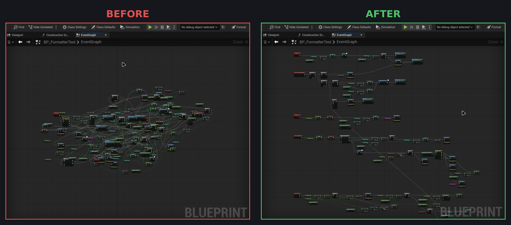

# Blueprint Formatter

One-click auto-layout for Unreal Engine Blueprint graphs. Adds a **Format** button to the Blueprint editor toolbar.



## What it does

- The main exec flow runs in a straight line from left to right, with wires aligned pin to pin.
- Extra outputs of Branch, Sequence, Switch, FlipFlop and loop nodes stack below the main line.
- Pure nodes (getters, math) are packed just left of the node that uses them.
- Separate events are stacked vertically. The first event stays where it was.
- Comment boxes are refit around the nodes they contain.

It only moves nodes. It never adds, deletes, or rewires anything, and one Ctrl+Z undoes the whole format.

## Install

Requires Unreal Engine 5.8 (it may build on earlier 5.x versions, but they are untested). Your project must be able to compile C++.

1. Clone or copy this repo into your project's `Plugins` folder:
   ```
   cd YourProject/Plugins
   git clone https://github.com/CodeSpartan/BlueprintFormatter.git
   ```
2. Build the editor target (or open the project and let it compile the plugin).

The plugin is editor-only and is enabled by default. It adds nothing to packaged games.

## Use

Open any Blueprint and click **Format** in the toolbar:

| Selection | What gets formatted |
|---|---|
| Nothing selected | The whole graph that is currently open |
| One node | Everything connected to that node |
| Several nodes | Exactly those nodes (a selected comment brings in its contents) |

To format with a key, bind one under **Editor Preferences → Keyboard Shortcuts → Blueprint Formatter → Format**. There is no default key.

## Known limitations

- When two branches join back into the same node, or one pure node feeds several nodes, it is placed next to its first user, so some wires stay long.
- When you format only some nodes, they can end up overlapping nodes that were not selected.
- The button appears in the regular Blueprint editor only. Widget Blueprints and Animation Blueprints are not supported yet.

## Tests

The layout code has automation tests. Run them from the Session Frontend, or headless:

```
UnrealEditor-Cmd YourProject.uproject -ExecCmds="Automation RunTests BlueprintFormatter; Quit" -unattended -NullRHI
```

## License

[Apache License 2.0](LICENSE)
